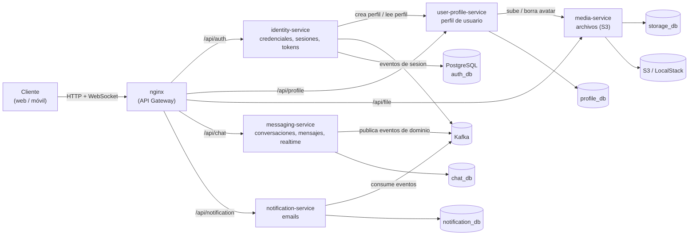
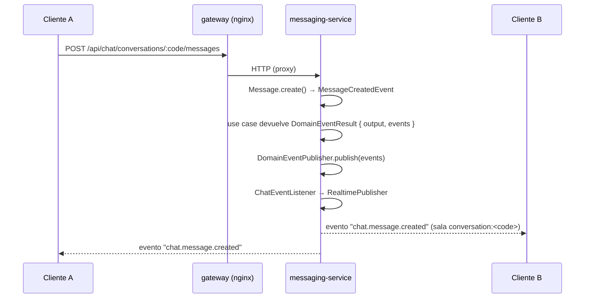

# Realtime Messaging Platform

Backend multi-servicio de una aplicación de mensajería en tiempo real (tipo WhatsApp): identidad,
perfiles, medios, conversaciones con mensajes persistidos y push por WebSocket.

**Node.js + TypeScript + Express 5 + TypeORM + PostgreSQL + Kafka + socket.io**, orquestado con
Docker Compose y expuesto detrás de un API Gateway (nginx). Cada servicio aplica **Domain-Driven
Design** (agregados, value objects, eventos de dominio) sin framework de dominio: solo TypeScript.

> 📘 **Referencia completa de la API**: [`docs/API.md`](docs/API.md)

---

## Índice

- [Qué resuelve](#qué-resuelve)
- [Arquitectura](#arquitectura)
- [Modelo de dominio](#modelo-de-dominio)
- [Realtime](#realtime)
- [Stack](#stack)
- [Ejecución local](#ejecución-local)
- [Estructura del repositorio](#estructura-del-repositorio)
- [Rutas públicas](#rutas-públicas)
- [Decisiones de diseño](#decisiones-de-diseño)
- [Estado y roadmap](#estado-y-roadmap)
- [Licencia](#licencia)

---

## Qué resuelve

Un backend de mensajería completo, listo para recibir un front:

- **Identidad**: signup, login, refresh y revocación de tokens (JWT de acceso + refresh), sesiones
  persistidas y estado de autenticación de la credencial.
- **Perfil**: datos de usuario con borrado lógico, compensación (rollback) si el alta falla a medias.
- **Medios**: subida y descarga de archivos sobre S3 (LocalStack en local), categorías y límites de
  tamaño/tipo.
- **Mensajería**: conversaciones 1:1 y grupales, mensajes con estado de entrega/lectura, edición,
  borrado lógico, acuses por participante y paginación por cursor.
- **Realtime**: push por socket.io de mensajes, acuses, cambios de participantes, presencia e
  indicador de escritura.
- **Notificaciones**: consumo de eventos de Kafka para enviar emails (sesión creada/revocada).

---

## Arquitectura



Cada servicio tiene **su propia base de datos** (ni una base compartida ni acceso directo a las
bases de otros servicios): la comunicación entre servicios es por HTTP o por eventos de Kafka.

---

## Modelo de dominio

Cada microservicio sigue la misma estructura, sin framework de dominio:

```
src/<contexto>/
├── domain/            # el modelo: no depende de Express, TypeORM ni Kafka
│   ├── aggregates/    # Conversation, Message, MessageReceipt, Profile, Session, Token…
│   ├── entities/      # entidades internas de un agregado (Participant)
│   ├── value-objects/ # invariantes encapsuladas (MessageContent, Email, DirectKey…)
│   ├── events/        # eventos de dominio (MessageCreatedEvent, SessionRevokedEvent…)
│   ├── exceptions/    # errores de dominio con código estable
│   ├── interfaces/    # Props / Create / Rehydrate / Primitives de cada agregado
│   ├── repositories/  # contratos (clases abstractas) de persistencia
│   ├── datasources/   # contratos de acceso a datos
│   ├── services/      # servicios de dominio (políticas que cruzan agregados)
│   └── use-cases/     # contratos de los casos de uso
├── application/       # orquestación: casos de uso, servicios de aplicación, mappers
└── infrastructure/    # TypeORM, HTTP (controller/router), mappers, factories
```

Reglas que se mantienen en todos los servicios:

| Regla | Dónde se ve |
|---|---|
| El agregado es el único que valida sus invariantes | `Conversation.addParticipant` rechaza duplicados y el último admin |
| Los contratos son **clases abstractas**, nunca interfaces | `CreateConversationUseCase`, `ProfileRepository` |
| Las entidades se crean con `create()` y se reconstruyen con `rehydrate()` | `Conversation.create` / `Conversation.rehydrate` |
| Los value objects son inmutables y normalizan la entrada | `Email.create` normaliza a minúsculas, `DirectKey` ordena y hashea |
| Los errores de dominio llevan un código estable | `CONVERSATION_NOT_PARTICIPANT` → HTTP 403 |
| Las dependencias entran por constructor; el wiring vive en una `*.factory.ts` | `chat.factory.ts` |

---

## Realtime

El socket es **push-only**: el cliente sigue actuando por REST y recibe las notificaciones por
WebSocket (socket.io en `/api/chat/socket.io`, autenticado con el mismo JWT del REST).



- **Salas (rooms)**: `user:<credentialCode>` y `conversation:<conversationCode>`. Al conectar, el
  socket entra automáticamente en las conversaciones del usuario; cuando se crea una conversación o
  se añade un participante, sus sockets entran/salen de la sala sin intervención del cliente.
- **Autenticación**: el JWT viaja en el handshake (`auth.token`), con fallback a `?token=` y a la
  cabecera `Authorization`. Sin token válido el socket se rechaza con `UNAUTHORIZED`.
- **Presencia e indicador de escritura**: estado efímero en memoria, sin persistencia.
- **Escalabilidad**: el fan-out entre réplicas aún no existe (el `DomainEventPublisher` es un
  adapter en memoria). El seam está preparado: basta sustituirlo por el publisher de Kafka y añadir
  un listener que re-emita a las salas locales.

---

## Stack

| Capa | Tecnología |
|---|---|
| Lenguaje | TypeScript 7 (modo estricto, `strict` + `exactOptionalPropertyTypes`) |
| Runtime | Node.js 26 |
| HTTP | Express 5 · `helmet` · `cors` · `express-validator` · `express-rate-limit` |
| Datos | TypeORM + PostgreSQL 16 (una base por servicio, `synchronize` en desarrollo) |
| Objetos | AWS SDK v3 (S3) · LocalStack en local |
| Mensajería | Kafka 4 (KRaft) · `kafkajs` · envelope estilo CloudEvents |
| Realtime | socket.io 4 (rooms, reconexión, heartbeat) |
| Infra | Docker Compose · nginx como API Gateway |

---

## Ejecución local

Requisitos: Docker + Docker Compose.

```bash
# 1. Variables del stack
cp .env.example .env

# 2. Variables de cada microservicio (una por servicio)
for s in identity user-profile media messaging notification; do
  cp microservices/$s-service/.env.example microservices/$s-service/.env
done

# 3. Levantar todo (desarrollo)
docker compose up --build -d
```

El gateway publica el puerto **80**: todas las llamadas van a `http://localhost/api/<servicio>`.

### Ejecución en producción

Para construir las imágenes con el `Dockerfile` de producción (multi-stage, sin volúmenes de desarrollo) y levantar el stack:

```bash
docker compose -f docker-compose.prod.yml up --build -d
```

El punto de entrada es el mismo gateway de nginx en el puerto **80**: `http://localhost/api/<servicio>`.

> Las contraseñas de base de datos se declaran en el `.env` raíz (`*_DB_PASSWORD`) y se inyectan en
> `init-scripts/01-init-databases.sh`, que crea un usuario y una base por servicio. Deben coincidir
> con `TORM_PASSWORD_DB` del `.env` de cada servicio.

Ejemplo rápido:

```bash
curl -X POST http://localhost/api/auth/signup \
  -H 'Content-Type: application/json' \
  -d '{"username":"ana","password":"Secret123*","profile":{"fullName":"Ana Ruiz"}}'
```

Cliente de WebSocket (hay ejemplos listos en `microservices/messaging-service/scripts/`):

```js
const socket = io("http://localhost", {
  path: "/api/chat/socket.io",
  transports: ["websocket"],
  auth: { token: "<accessToken>" },
});

socket.on("chat.message.created", (payload) => console.log(payload));
```

---

## Estructura del repositorio

```
.
├── docker-compose.yml          # stack completo (6 servicios + gateway + postgres + kafka + localstack)
├── init-scripts/               # creación de usuarios y bases de datos al iniciar Postgres
├── docs/API.md                 # referencia completa de la API (endpoints, errores, ejemplos)
├── microservices/
│   ├── api-gateway/            # configuración de nginx (routing + soporte WebSocket)
│   ├── identity-service/       # credenciales, sesiones, tokens, eventos de sesión
│   ├── user-profile-service/   # perfil de usuario
│   ├── media-service/          # archivos sobre S3
│   ├── messaging-service/      # conversaciones, mensajes y realtime
│   └── notification-service/   # consumidor de Kafka → email
└── templates/
    └── scaffold-service/       # plantilla para crear un microservicio nuevo (sin seguimiento)
```

---

## Rutas públicas

El prefijo público de cada API es estable aunque el nombre interno del servicio cambie
(el gateway resuelve la tabla `map $api_service $upstream` de `nginx.conf`).

| Ruta pública | Servicio | Contenido |
|---|---|---|
| `/api/auth/*` | `identity-service` | signup, signin, refresh, sesiones, revocación |
| `/api/profile/*` | `user-profile-service` | perfil, avatar |
| `/api/file/*` | `media-service` | subida, descarga y borrado de archivos |
| `/api/chat/*` | `messaging-service` | conversaciones, mensajes y WebSocket |
| `/api/notification/*` | `notification-service` | health del consumidor de eventos |

Detalle de endpoints, validaciones y códigos de error: [`docs/API.md`](docs/API.md).

---

## Decisiones de diseño

| Decisión | Motivo | Coste asumido |
|---|---|---|
| DDD sin framework | El modelo se lee como el de cualquier dominio: sin decoradores ni metadata magic. El coste es repeter unas pocas convenciones por servicio | Código repetido (interfaces, mappers, datasources) |
| Un agregado por contexto, `Message` independiente de `Conversation` | El historial no se carga en memoria al leer una conversación; escala a millones de mensajes | Dos agregados que Coordinating que el mensaje pertenezca a la conversación |
| Eventos de dominio en el agregado + `DomainEventResult` | Los eventos nacen junto a la regla de negocio que los origina, no en la capa HTTP | Cada caso de uso devuelve `{ output, events }` |
| Identidad por `credentialCode` en el JWT | El chat puede identificar al usuario sin llamar a `identity-service` en cada request | El token debe incluir ese campo (tokens antiguos no sirven: hay que iniciar sesión de nuevo) |
| Paginación por cursor (`createdAt + code`) | Con `offset` el rendimiento se degrada en listados largos; el cursor es estable con inserciones | El cursor es opaco para el cliente |
| Clave única derivada (`direct_key`) para el 1:1 | Impide crear dos chats 1:1 entre los mismos dos usuarios, incluso en paralelo | Índice único parcial sobre conversations |
| Soft delete con columna propia | Permite "deshacer" y auditar; los mensajes borrados no se listan | Hay que filtrar explícitamente en las consultas |
| socket.io como transporte push | Rooms, reconexión y heartbeat resueltos; el cliente no tiene que reimplementar el protocolo | No es WebSocket estándar: el cliente usa el SDK de socket.io |
| `Connection` condicional y timeouts largos en nginx | Con la config anterior nginx forzaba `upgrade` en todas las peticiones y cortaba las conexiones ociosas a los 60 s | Algo de config que mantener a mano |

---

## Estado y roadmap

**Implementado**: identidad y sesiones · perfiles · archivos S3 · conversaciones 1:1 y grupales ·
mensajes con entrega/lectura, edición y borrado lógico · acuses por participante · paginación por
cursor · realtime (mensajes, acuses, participantes, presencia, typing) · eventos de dominio con
Kafka en `identity-service` y `notification-service`.

**Pendiente**:

- [ ] Tests automatizados del dominio (agregados, value objects, políticas).
- [ ] CI con GitHub Actions (lint, typecheck, tests).
- [ ] Fan-out entre réplicas de `messaging-service` vía Kafka (para balanceador de carga).
- [ ] Adjuntos en los mensajes (integración con `media-service`).
- [ ] Borrado de mensajes "solo para mí" (visibilidad por participante).
- [ ] OpenAPI/Swagger y observabilidad (métricas y tracing).

---

## Licencia

[MIT](LICENSE) © 2026 Joel Cabrera Parrales
